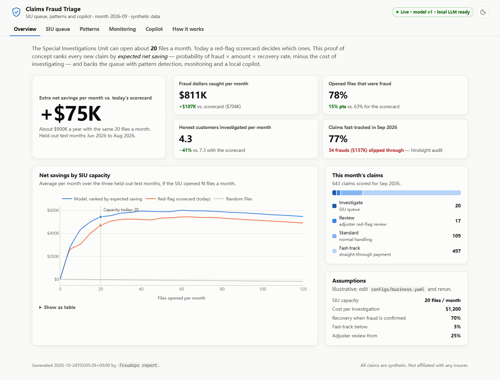
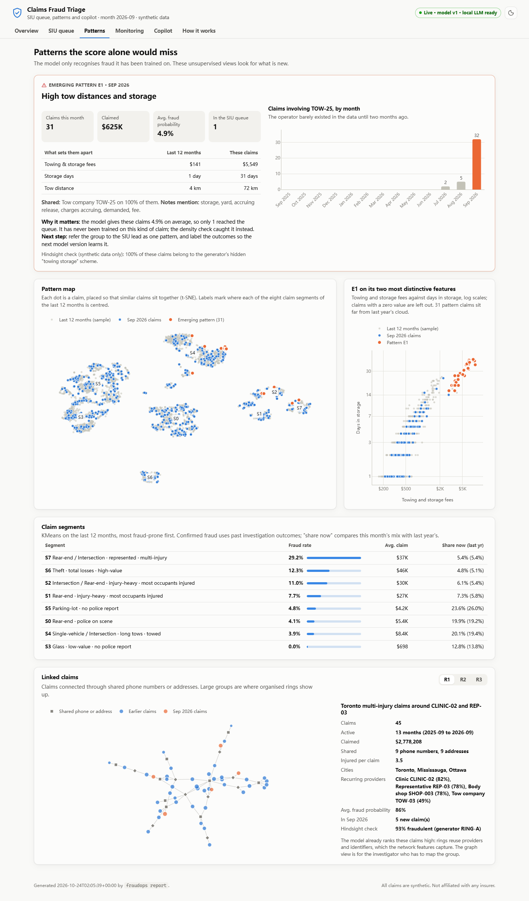
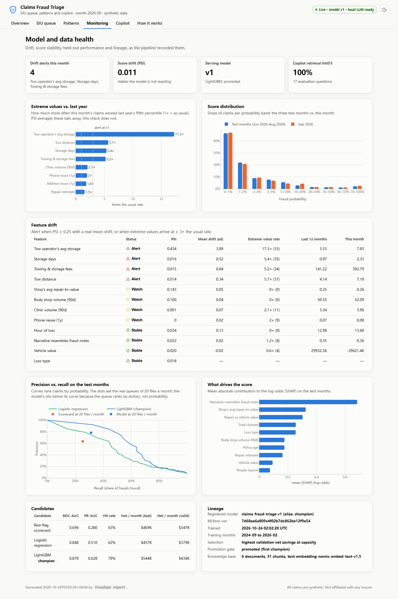
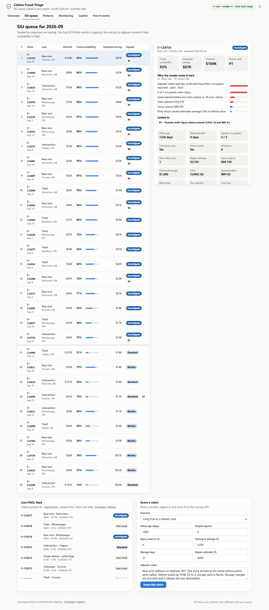
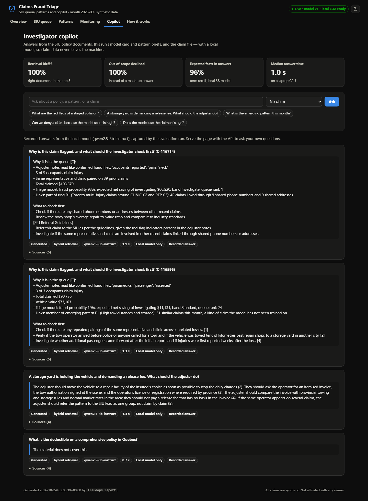
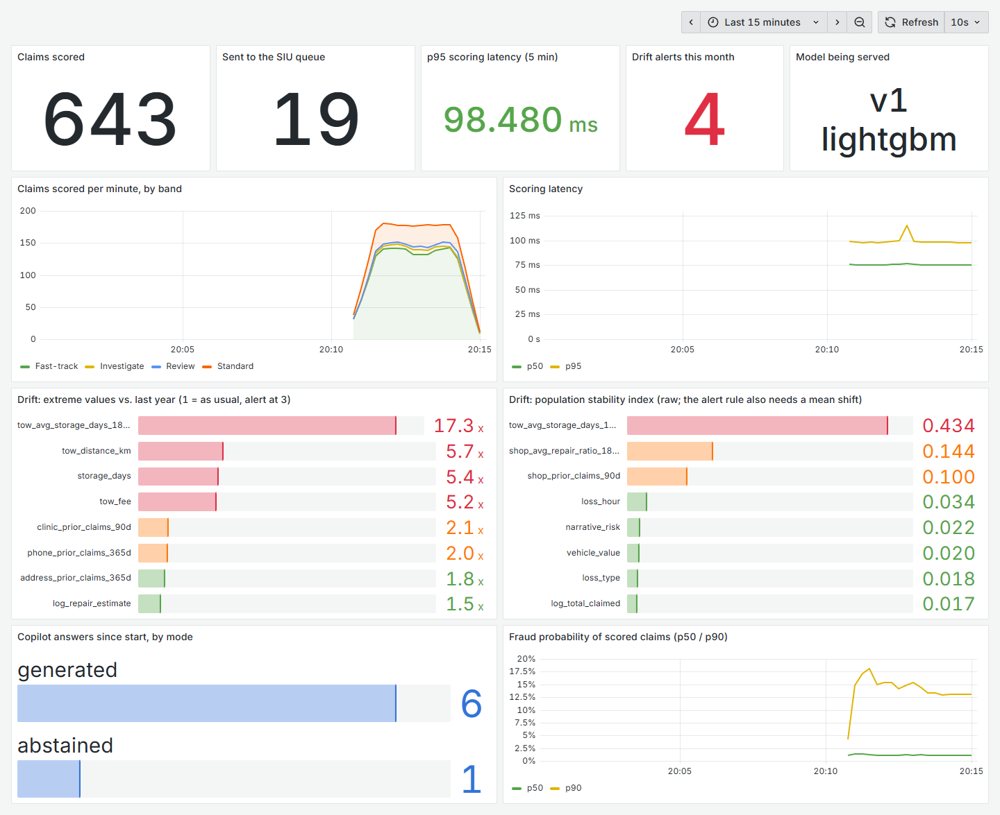
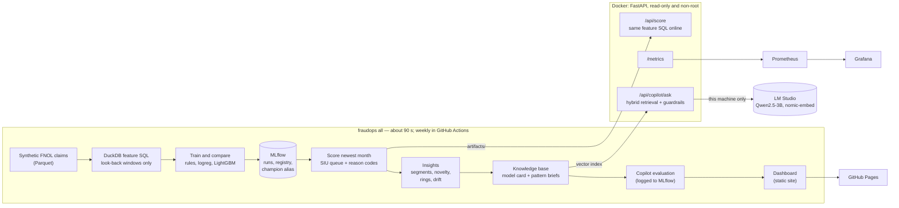

# Claims Fraud Triage &mdash; an end-to-end MLOps + local RAG proof of concept

**Which 20 claims should the Special Investigations Unit open this month?**
This project ranks every new auto-insurance claim by *expected net saving*, catches the fraud the
model has never seen with unsupervised monitoring, and gives investigators a copilot that runs on a
laptop. Synthetic data, open-source tools, $0 to run, one command to rebuild.

[](https://github.com/jma-repo/claims-fraud-mlops/actions/workflows/ci.yml)


**Live dashboard (static snapshot):** https://jma-repo.github.io/claims-fraud-mlops/



## Results

Held-out test months (Jun&ndash;Aug 2026), with the SIU's real capacity of 20 files a month:

| | Red-flag scorecard (today) | Logistic regression | **LightGBM (champion)** |
|---|---:|---:|---:|
| ROC-AUC | 0.696 | 0.848 | **0.878** |
| PR-AUC | 0.280 | 0.510 | **0.628** |
| Opened files that turned out to be fraud | 63% | 62% | **78%** |
| Fraud dollars caught per month | $704K | $687K | **$811K** |
| Honest customers investigated per month | 7.3 | 7.7 | **4.3** |
| **Net savings per month** | $469K | $457K | **$544K** |

* **+$75K a month (about $0.9M a year) with the same SIU headcount, and 41% fewer honest customers investigated.**
  The candidate was chosen on validation net savings, not AUC; logistic regression beats the scorecard on AUC
  and still loses on dollars, which is why the business metric decides.
* **The newest month contains a scheme the model has never seen** (tow trucks that arrive unasked, tow to a
  distant yard and run up storage fees). The model scores those 31 claims at 4.9% on average and queues one.
  The monitor flags towing fees, storage days and tow distance (5&ndash;17&times; the usual rate of extreme values,
  invisible to PSI), and a density-ratio detector groups exactly those 31 claims ($625K claimed). In hindsight,
  all 31 were fraudulent.
* **Copilot** (local Qwen2.5-3B + nomic embeddings): right document in the top 3 for 100% of evaluation
  questions, 100% of out-of-scope questions declined, 96% of expected facts present in answers, median answer
  time 1.0 s on a laptop CPU. Claim data never leaves the machine.

Assumptions (cost per investigation $1,200, recovery rate 70%, capacity 20) live in
[`configs/business.yaml`](configs/business.yaml) and are printed next to every dollar figure.

| Patterns | Monitoring |
|---|---|
|  |  |
| **SIU queue with reason codes** | **Investigator copilot** |
|  |  |

Service metrics in Grafana while the newest month is replayed through the API (`docker compose --profile monitoring up`):



## The business problem

An SIU can only open so many files. Today a red-flag scorecard picks them: points for a new policy, multiple
soft-tissue injuries, no police report and so on. That misses fraud that does not trip the rules, investigates
honest customers who do, and ignores how much money is at stake. This PoC changes the decision, not just the score:

* **Rank by expected net saving:** `P(fraud) × claimed amount × recovery rate − investigation cost`, month by
  month, within capacity, and skip files whose expected saving is negative.
* **Explain every ranking** with reason codes an investigator can check (SHAP for the tree model, matched terms
  from the adjuster notes).
* **Watch for what the model cannot know:** drift, kinds of claims that suddenly became common, rings linked by
  shared phones and addresses.
* **Shorten each investigation** with a copilot grounded in the SIU's own policies and this run's findings.

## Architecture



## The MLOps stack, cut down to a PoC

| Stage | Reference stack | This PoC | Why | Production path (Azure) |
|---|---|---|---|---|
| Data | Kafka, Spark, Flink, Redis | Parquet + DuckDB; API replay as the event stream; DuckDB table as online store | Single node handles millions of rows; the same SQL runs on Spark | Event Hubs/Kafka &rarr; Databricks (Delta) &rarr; feature store |
| Experiment tracking | MLflow | MLflow (SQLite) with model registry, aliases, champion/challenger gate | Same tool, zero infrastructure | Databricks managed MLflow or Azure ML |
| Orchestration | Airflow, Kubeflow | `fraudops all` + scheduled GitHub Actions run | Eight steps do not need a scheduler cluster | Databricks Workflows, ADF or Airflow |
| Deployment | FastAPI, Docker, Kubernetes | FastAPI + Docker Compose, hardened container | Kubernetes adds nothing for one service | AKS or Azure Container Apps |
| Monitoring | Prometheus, Grafana | Prometheus + provisioned Grafana dashboard; PSI and tail-ratio drift in the pipeline | Same tools | Azure Monitor / Managed Grafana |
| Cloud platform | SageMaker, Azure ML, Vertex, Databricks | None: runs on a laptop | Prove value before spending money | Azure ML or Databricks |
| CI/CD | Git, GitHub Actions | Lint, 49 tests, pipeline smoke run, image build and boot, Pages deploy | Free for public repositories | Same, plus environments and approvals |
| LLMOps | vLLM, vector DB, LangSmith | LM Studio (OpenAI-compatible API), DuckDB vector search + BM25, evaluation in MLflow | Data stays on the machine; no API bill | vLLM or Azure OpenAI, Azure AI Search, MLflow tracing |

## Quickstart

**Just look:** open the [live dashboard](https://jma-repo.github.io/claims-fraud-mlops/) or `site/index.html`.

**Run the service from the committed artifacts** (no training; needs Docker):

```bash
docker compose up --build
```

Then open http://127.0.0.1:8000. Add Prometheus and Grafana with
`docker compose --profile monitoring up --build` (Grafana on http://127.0.0.1:3000).

**Rebuild everything from scratch** (needs [uv](https://docs.astral.sh/uv/)):

```bash
uv sync
uv run fraudops all
uv run fraudops serve
```

In a second terminal, stream the newest month into the API like live first-notice-of-loss events, and look at
the experiments:

```bash
uv run fraudops replay --rate 5
uv run mlflow ui --backend-store-uri sqlite:///mlflow.db
```

**Local LLM (optional):** install [LM Studio](https://lmstudio.ai), load `qwen2.5-3b-instruct` and
`text-embedding-nomic-embed-text-v1.5`, start its server on port 1234. Without it everything still runs: retrieval
falls back to keywords and the copilot returns the evidence instead of a written answer.

Run `uv run fraudops --help` for the individual steps, and `uv run pytest` for the tests.

## How it works

**Data.** [`generate.py`](src/fraudops/generate.py) writes 25 months of claims for a regional book in
Alberta, Ontario and the Maritimes, with seven documented fraud mechanisms: staged-collision rings,
repair build-up, injury build-up, owner give-ups, post-loss policy inception, soft padding, and a towing/storage
scheme that only appears at the very end. Legitimate claims share the red flags on purpose (families with several
injured passengers, new customers, lawyers on real injuries), and providers and people are coded IDs.

**Features.** One SQL file, [`sql/features.sql`](sql/features.sql), runs in DuckDB for training *and* for every
claim the API scores. Every window looks strictly backwards in time, so nothing leaks from the future;
tests prove that a claim replayed through the API gets exactly the batch features and the batch probability.

**Model.** A TF-IDF narrative model (out-of-fold, place names scrubbed) feeds a LightGBM model alongside
claim, policy and network features (phone and address reuse, provider volumes, repeated
representative-and-clinic pairings). Platt calibration keeps probabilities usable for dollar ranking.
Splits are by time: 18 months train, 3 validate, 3 test.

**Tracking and promotion.** Every candidate is an MLflow run; the winner is logged as a models-from-code pyfunc,
registered, and only gets the `champion` alias if it beats the current champion's test net savings.

**Serving.** FastAPI with a strict request schema, reason codes, Prometheus metrics, security headers, and the
dashboard. The image runs read-only, as a non-root user, with all Linux capabilities dropped.

**Monitoring.** Population stability index per feature, plus a tail check (how often values exceed last year's
99th percentile), because a new scheme starts as a few dozen extreme claims that PSI averages away.

**Patterns.** KMeans segments for the last 12 months; a domain classifier that estimates how much more common
each kind of claim has become this month (density ratio), with flagged claims grouped into patterns; and a graph
of claims linked by shared identifiers to surface rings.

**Copilot.** Policy documents plus a model card and pattern briefs generated by the same run, chunked and indexed
in DuckDB (`array_cosine_similarity`) with BM25 for hybrid retrieval. Guardrails sit outside the prompt: questions
that match nothing are declined without calling the model, answers that call a claim fraudulent are regenerated or
withheld, the "why" of a claim comes word for word from the reason codes, and the client refuses any model server
that is not on this machine.

## Responsible AI

* The score is a triage signal, never evidence; the copilot recommends verification steps, not decisions.
* Not used as model inputs: the claimant's age (a protected ground), the city, and place names in the notes
  (proxies for neighbourhood). Providers enter only through their behaviour.
* The dashboard reports honest customers investigated and a hindsight audit of the fast-track, not only dollars.

## Limitations and next steps

* Synthetic data: the absolute numbers are illustrative; the method and the comparisons are the point.
* Real labels exist only for investigated claims, so a production model needs a strategy for selection bias.
* A 3B model writes good short answers but cites inconsistently (inline citations in 50% of answers); a 7B+
  model or vLLM on a GPU would raise that, and the evaluation harness is ready to measure it.
* Next: retrain with the newly labelled towing claims and let the promotion gate decide; move features to a
  feature store; run the pipeline on Databricks against Delta tables.

## Repository layout

```text
configs/            pipeline and business assumptions
sql/features.sql    the single feature definition (batch and online)
src/fraudops/       generate, features, train, score, insights, rag/, api/, report/
knowledge/          SIU policy documents for the copilot (fictional)
eval/               copilot evaluation questions
tests/              49 tests: leakage, parity, business rules, drift, RAG guardrails, API
monitoring/         Prometheus config and the provisioned Grafana dashboard
artifacts/          committed release snapshot: model bundle, serving tables, index, reports
site/               the dashboard, published to GitHub Pages
```

## License

MIT. All claims, providers and people in this repository are synthetic; the policy documents are fictional
and do not describe any real insurer.
